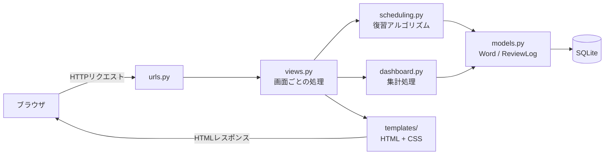
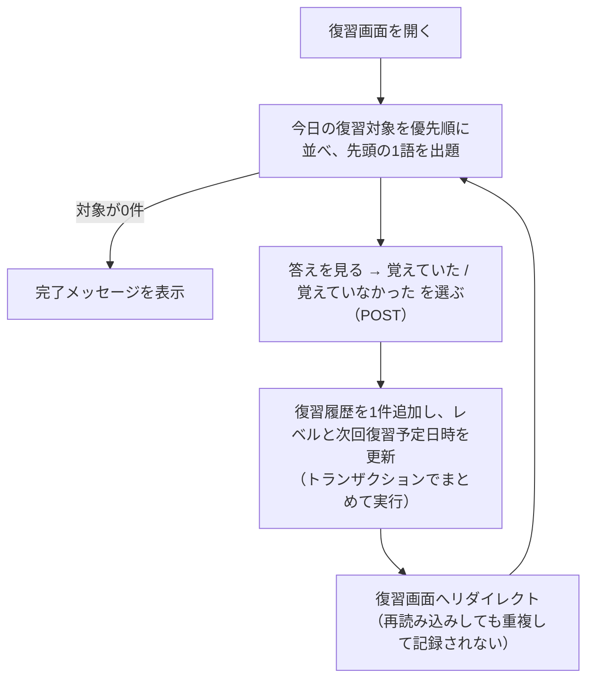
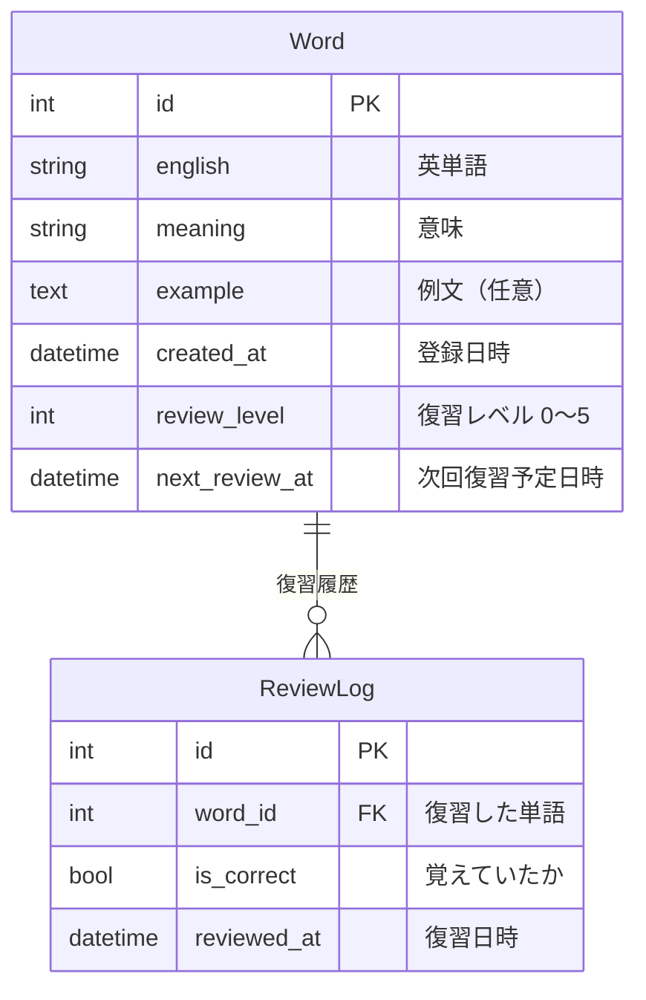

# TOEIC単語帳 ― 間隔反復で復習する英単語学習アプリ

TOEIC対策の英単語を登録し、**「いつ、どの単語を復習すべきか」をルールに基づいて自動で決める** Webアプリです。
Python / Django で開発しています。

> 復習のタイミングは、あらかじめ決めたルール（間隔反復）で計算しています。
> 機械学習や外部のAIサービスは使用していません。

---

## 目次

- [開発背景と目的](#開発背景と目的)
- [解決したい課題](#解決したい課題)
- [主な機能](#主な機能)
- [使用技術](#使用技術)
- [システム構成](#システム構成)
- [間隔反復アルゴリズムの仕組み](#間隔反復アルゴリズムの仕組み)
- [データベースの構成](#データベースの構成)
- [ローカル環境での起動方法](#ローカル環境での起動方法)
- [テストの実行方法](#テストの実行方法)
- [今後の改善予定](#今後の改善予定)

---

## 開発背景と目的

TOEICの単語学習では、一度覚えた単語も時間がたつと忘れてしまいます。
一方で、すでに覚えている単語を毎日復習するのは時間の無駄になります。

そこで、**忘れかけた頃に復習する「間隔反復」の考え方**をWebアプリとして実装し、
限られた学習時間を「今日復習すべき単語」に集中させることを目的に開発しました。

あわせて、Django のモデル設計・ORMによる集計・自動テスト・タイムゾーンの扱いなど、
Webアプリ開発の基礎を実践的に身につけることも目的としています。

## 解決したい課題

| 課題 | このアプリでの解決方法 |
|---|---|
| どの単語をいつ復習すればよいか分からない | 復習結果から次回復習日を自動計算し、今日の分だけを出題する |
| 覚えた単語と苦手な単語が区別できない | 単語ごとに復習レベル・正答率・不正解回数を記録して表示する |
| 学習の積み重ねが見えず、続けにくい | ダッシュボードで今日の成果と過去7日間の復習回数を表示する |

## 主な機能

### 単語の管理
- 英単語・意味・例文（任意）の登録
- 登録した単語の一覧表示（復習レベル・正答率・復習回数・次回復習予定日・今日の復習対象かどうか）
- 単語の削除（確認画面あり。単語の復習履歴も一緒に削除されます）

### 復習
- 今日復習すべき単語を、優先度の高い順に1問ずつ出題
- 最初は英単語だけを表示し、「答えを見る」で意味と例文を表示
- 「覚えていた」「覚えていなかった」の **自己採点** で結果を記録
- 本日の残り件数の表示、すべて終わったら完了メッセージを表示

### 学習履歴・ダッシュボード
- 復習するたびに結果と日時を履歴として保存（過去の記録は上書きされず蓄積）
- サマリー：登録単語数／今日の残り復習数／今日の復習回数・正解回数・正答率／累計復習回数
- 過去7日間の日別復習回数の棒グラフ（正解・不正解の内訳つき、表でも確認可能）
- 復習レベル別の単語数のグラフ

### 画面・操作性
- PC・タブレット・スマートフォンの画面幅に対応したレイアウト
- キーボード操作、フォーカス表示、ラベル付きフォームなどのアクセシビリティへの配慮
- グラフは HTML と CSS のみで描画（JavaScript・外部ライブラリ不使用）

## 使用技術

| 分類 | 技術 |
|---|---|
| 言語 | Python 3.12 |
| フレームワーク | Django 6.1 |
| データベース | SQLite |
| フロントエンド | HTML（Djangoテンプレート）、CSS |
| テスト | Django標準のテスト機能（`unittest` ベース） |

外部の Python パッケージは Django とその依存パッケージのみです（[requirements.txt](requirements.txt)）。

## システム構成



画面の処理（views）から、**復習アルゴリズム（scheduling.py）と集計処理（dashboard.py）を別のファイルに分けて**います。
アルゴリズムを改良するときに、画面側のコードを変更せずに済むようにするためです。

### ディレクトリ構成

```
toeic-review-app/
├── config/                 # プロジェクト全体の設定（settings.py, urls.py など）
│   └── env.py              # .env ファイルの読み込み
├── vocab/                  # 単語学習アプリ本体
│   ├── models.py           # データベースの設計（Word, ReviewLog）
│   ├── views.py            # 画面ごとの処理
│   ├── urls.py             # URLと画面の対応
│   ├── forms.py            # 単語登録フォーム
│   ├── scheduling.py       # 間隔反復アルゴリズム
│   ├── dashboard.py        # ダッシュボードの集計
│   ├── admin.py            # Django管理画面の設定
│   ├── tests.py            # 自動テスト
│   ├── migrations/         # データベースの変更履歴
│   ├── templates/vocab/    # HTMLテンプレート
│   └── static/vocab/css/   # CSS
├── scripts/
│   └── create_env.py       # ローカル開発用の .env を作成するスクリプト
├── .env.example            # 環境変数の設定例（本物の秘密鍵は書かない）
├── manage.py
└── requirements.txt
```

### 画面一覧

| URL | 画面 |
|---|---|
| `/` | 単語一覧・登録 |
| `/words/<id>/delete/` | 削除の確認 |
| `/review/` | 復習（出題） |
| `/review/<id>/answer/` | 復習結果の保存（POSTのみ。保存後は `/review/` へリダイレクト） |
| `/dashboard/` | ダッシュボード |
| `/admin/` | Django管理画面 |

## 間隔反復アルゴリズムの仕組み

実装は [vocab/scheduling.py](vocab/scheduling.py) にまとめています。

### 1. 復習レベルと次回復習日

各単語は **復習レベル（0〜5）** と **次回復習予定日時** を持っています。

- 登録直後：レベル0、次回復習予定 = 登録した時刻（すぐに復習対象になります）
- 「覚えていた」：レベルを1つ上げる（上限5）
- 「覚えていなかった」：レベルを0に戻す

```
正解したとき:   新しいレベル = min(現在のレベル + 1, 5)
不正解のとき:   新しいレベル = 0

次回復習予定日時 = 復習した日時 + 間隔（新しいレベルで決まる）
```

| 新しいレベル | 0（不正解） | 1 | 2 | 3 | 4 | 5 |
|---|---|---|---|---|---|---|
| 次回復習までの間隔 | 1日 | 1日 | 3日 | 7日 | 14日 | 30日 |

**例：** 新しく登録した単語を毎回「覚えていた」と答えると、次回復習日は 1日後 → 3日後 → 7日後 → 14日後 → 30日後 と間隔が延びていきます。
途中で「覚えていなかった」と答えるとレベル0に戻り、翌日にもう一度出題されます。

間隔の日数はコード内の定数（`REVIEW_INTERVAL_DAYS`、`INCORRECT_INTERVAL_DAYS`）として管理しているため、変更が容易です。

### 2. 今日の復習対象の判定

```
今日の復習対象  ⇔  次回復習予定日時 < 明日の0:00（日本時間）
```

時刻ちょうどではなく「今日中に予定がある単語」を対象にしています。
データベースの日時はUTCで保存されますが、日付の区切りは `TIME_ZONE = "Asia/Tokyo"` を基準に計算しています。
回答すると次回予定が最低1日後に延びるため、同じ日に同じ単語が出題され続けることはありません。

### 3. 出題の優先順位

今日の復習対象が複数ある場合は、次の順に並べて先頭の1語を出題します。

1. 次回復習予定日時が古い順（長く待たされている単語を先に）
2. 不正解回数が多い順（苦手な単語を先に）
3. 復習レベルが低い順
4. 単語のID順（ここまで同じでも、毎回同じ順番になるようにする）

### 4. 処理の流れ



## データベースの構成



- **Word**：単語1件と、その単語の現在の復習スケジュール
- **ReviewLog**：復習1回分の結果。復習するたびに1行追加し、上書きはしません
- 復習回数・正答率・最終復習日時などは ReviewLog から集計して表示しています（Django ORM の `annotate` / `aggregate` を使用）
- 単語を削除すると、その単語の ReviewLog も一緒に削除されます

## ローカル環境での起動方法

### 必要なもの
- Python 3.12
- Git

### 手順（Windows / PowerShell）

```powershell
# 1. リポジトリを取得してフォルダに移動
git clone <このリポジトリのURL>
cd toeic-review-app

# 2. 仮想環境を作成して有効化
python -m venv .venv
.venv\Scripts\Activate.ps1

# 3. 必要なパッケージをインストール
pip install -r requirements.txt

# 4. 秘密鍵を入れた .env ファイルを作成（最初の1回だけ）
python scripts/create_env.py

# 5. データベースを作成
python manage.py migrate

# 6. 開発用サーバーを起動
python manage.py runserver
```

ブラウザで http://127.0.0.1:8000/ を開くと、単語一覧画面が表示されます。
2回目以降は、手順2の仮想環境の有効化と、手順6の `runserver` だけで起動できます。

macOS / Linux の場合は、手順2の有効化コマンドを `source .venv/bin/activate` に読み替えてください。

> データベース（`db.sqlite3`）はリポジトリに含めていません。手順5で空のデータベースが作成されます。

### 環境変数の設定

Django の秘密鍵（`SECRET_KEY`）は、ソースコードには書かず、環境変数 `DJANGO_SECRET_KEY` から読み込んでいます。

| 環境変数 | 必須 | 内容 |
|---|---|---|
| `DJANGO_SECRET_KEY` | 必須 | Django の秘密鍵。推測されにくい長いランダムな文字列 |

ローカル開発では、プロジェクト直下の `.env` ファイルに書いておくと、起動時に自動で読み込まれます（[config/env.py](config/env.py)）。

- **`python scripts/create_env.py`** を実行すると、ランダムな秘密鍵が入った `.env` が自動で作られます。すでに `.env` がある場合は上書きしません
- 手動で作る場合は、[.env.example](.env.example) を `.env` という名前でコピーし、`DJANGO_SECRET_KEY=` の後に値を書いてください
- `.env` は `.gitignore` で除外しているため、リポジトリには含まれません。**他の人に共有したり、コミットしたりしないでください**
- 同じ名前の環境変数がすでに設定されている場合は、`.env` よりもそちらが優先されます
- 秘密鍵が設定されていない状態で起動すると、作成方法を案内するエラーメッセージが表示されます

### 管理画面を使う場合（任意）

```powershell
python manage.py createsuperuser
```

作成したアカウントで http://127.0.0.1:8000/admin/ にログインすると、単語と復習履歴を確認できます。

## テストの実行方法

```powershell
python manage.py test vocab
```

現在 **83件** の自動テストがあります。テストの実行にも `.env`（または環境変数 `DJANGO_SECRET_KEY`）が必要です。主に以下を確認しています。

- 単語の登録・一覧表示・削除
- 復習結果の保存、POST以外のリクエストの拒否、CSRF対策
- 復習レベルと次回復習予定日時の計算（レベル上限、不正解時のリセット）
- 今日の復習対象の判定と出題の優先順位（日付の境界・日本時間での日付の区切りを含む）
- ダッシュボードの集計（0件のとき、過去7日間の範囲の端など）
- 既存データ用マイグレーションでの履歴の再計算
- 画面の構成（テンプレートの読み込み、HTMLタグの対応、ナビゲーション、フォームのエラー表示など）
- `.env` ファイルの読み込み

テストでは現在日時を固定しているため、実行する日によって結果が変わりません。

## 今後の改善予定

以下は **まだ実装していない** 機能です。

- ユーザー登録・ログイン機能（ユーザーごとに単語帳を分ける）
- 単語の編集・検索・絞り込み
- 本番環境向けの設定（`DEBUG`・`ALLOWED_HOSTS` の環境変数化、HTTPS関連の設定など）と、Webサーバーへのデプロイ
  （秘密鍵の環境変数化は実装済み）
- 正答率や復習の遅れを考慮した、復習間隔の調整方法の検討
- 1日に復習する単語数の上限設定
- 連続学習日数の表示、今後の復習予定数の表示
- ブラウザを使ったE2Eテストの追加
