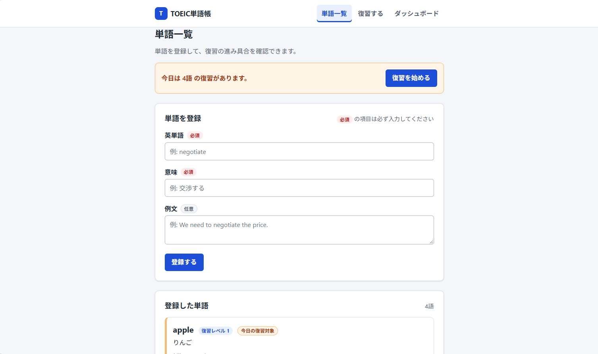
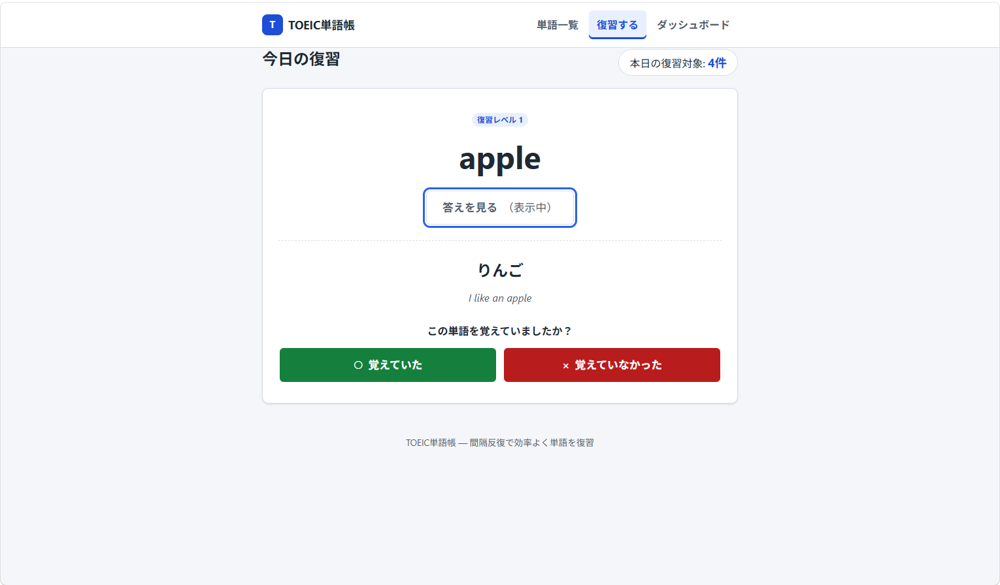
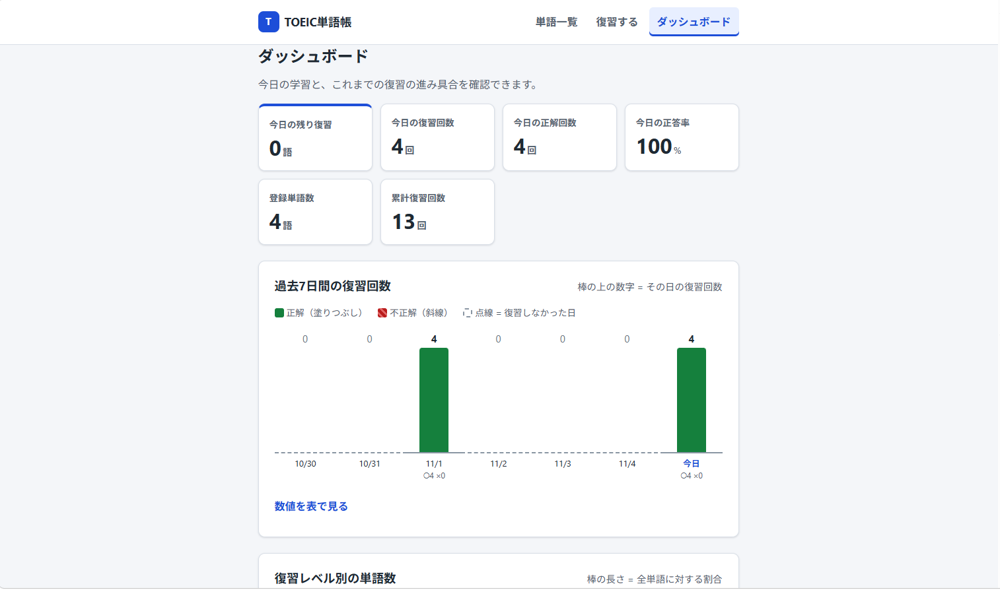
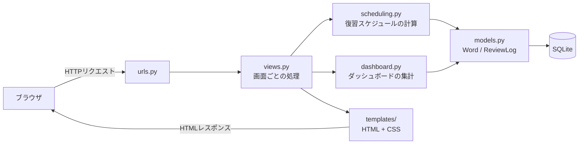
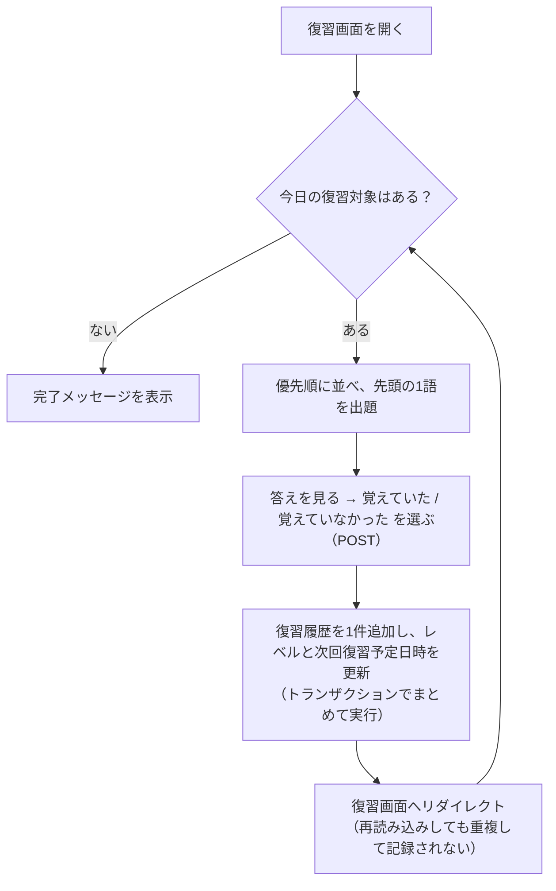
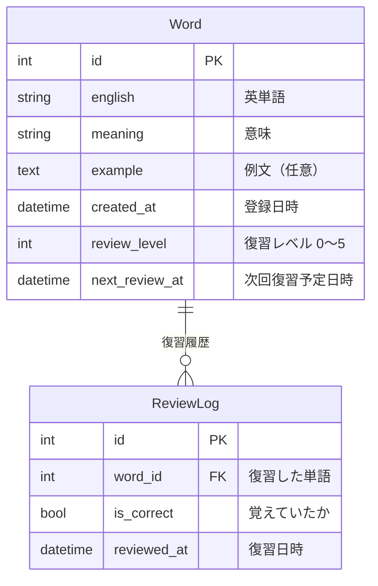

# TOEIC単語帳 ― 学習履歴に合わせて復習タイミングを調整する英単語アプリ

TOEIC対策の英単語を登録し、復習の結果（覚えていたかどうか）に応じて **「次にいつ復習するか」を自動で計算する** Webアプリです。
Python / Django で個人開発しています。

> 復習のタイミングは、あらかじめ決めたルール（間隔反復）で計算しています。
> アプリの機能として、機械学習やAIによる予測・判定は組み込んでいません。

### このアプリのポイント

1. **今日復習すべき単語だけを出題** ― 正解するほど次の復習までの間隔が延び（1日→3日→7日→14日→30日）、忘れた単語は翌日にもう一度出題されます
2. **学習履歴をすべて記録して見える化** ― 復習1回ごとの結果を保存し、正答率・復習レベル・過去7日間の復習回数をダッシュボードで確認できます
3. **テストで動作を保証** ― 83件の自動テストで、アルゴリズムの計算・日付の境界・画面表示を確認しています

---

## 目次

- [スクリーンショット](#スクリーンショット)
- [開発背景と目的](#開発背景と目的)
- [解決したい課題](#解決したい課題)
- [主な機能](#主な機能)
- [使用技術](#使用技術)
- [システム構成](#システム構成)
- [復習タイミングを決める仕組み](#復習タイミングを決める仕組み)
- [データベースの構成](#データベースの構成)
- [工夫した点](#工夫した点)
- [テスト](#テスト)
- [ローカル環境での起動方法](#ローカル環境での起動方法)
- [今後の改善予定](#今後の改善予定)

---

## スクリーンショット

### 単語登録・一覧画面



画面上部に今日の復習件数と「復習を始める」ボタンを表示しています。
登録フォームでは、必須項目と任意項目をラベルで区別しています。
その下に登録した単語が並び、各単語に復習レベルと「今日の復習対象」のバッジが付きます。

### 復習画面



「答えを見る」を押して、意味と例文を表示した状態です。
「覚えていた」「覚えていなかった」のボタンで自己採点します。
画面右上には、本日の復習対象の件数を表示しています。

### 学習ダッシュボード



今日の残り復習数・復習回数・正解回数・正答率、登録単語数、累計復習回数をカードで表示しています。
その下には、過去7日間の日別の復習回数を棒グラフで表示しています。

---

## 開発背景と目的

TOEICの学習を進める中で、英単語の復習を効率化したいと考え、このアプリを開発しました。

単語を登録するだけでなく、復習時の正解・不正解を記録し、その結果に応じて次回の復習日を自動的に調整する仕組みを実装しました。

これにより、復習する単語とタイミングを把握しやすくすることを目指しました。

## 解決したい課題

| 課題 | このアプリでの解決方法 |
|---|---|
| どの単語をいつ復習すればよいか分からない | 復習結果から次回復習日を自動計算し、今日の分だけを出題する |
| 覚えた単語と苦手な単語が区別できない | 単語ごとに復習レベル・正答率・不正解回数を記録して表示する |
| 学習の積み重ねが見えず、続けにくい | ダッシュボードで今日の成果と過去7日間の復習回数を表示する |

## 主な機能

### 単語の管理
- 英単語・意味・例文（任意）の登録
- 登録した単語の一覧表示（復習レベル・正答率・復習回数・次回復習予定日・今日の復習対象かどうか）
- 単語の削除（確認画面あり。単語の復習履歴も一緒に削除されます）

### 復習
- 今日復習すべき単語を、優先度の高い順に1問ずつ出題
- 最初は英単語だけを表示し、「答えを見る」で意味と例文を表示
- 「覚えていた」「覚えていなかった」の **自己採点** で結果を記録（自動採点ではありません）
- 本日の残り件数を表示し、すべて終わったら完了メッセージを表示

### 学習履歴・ダッシュボード
- 復習するたびに結果と日時を履歴として保存（過去の記録は上書きされず蓄積）
- サマリー：登録単語数／今日の残り復習数／今日の復習回数・正解回数・正答率／累計復習回数
- 過去7日間の日別復習回数の棒グラフ（正解・不正解の内訳つき、表でも確認可能）
- 復習レベル別の単語数のグラフ

### 画面・操作性
- PC・タブレット・スマートフォンの画面幅に対応したレイアウト
- キーボード操作、フォーカス表示、ラベル付きフォームなどのアクセシビリティへの配慮
- グラフは HTML と CSS のみで描画（JavaScript・グラフ用ライブラリは不使用）

## 使用技術

| 分類 | 技術 |
|---|---|
| 言語 | Python 3.12 |
| フレームワーク | Django 6.1 |
| データベース | SQLite |
| フロントエンド | HTML（Djangoテンプレート）、CSS |
| テスト | Django標準のテスト機能（`unittest` ベース） |
| バージョン管理 | Git |

外部の Python パッケージは Django とその依存パッケージのみです（[requirements.txt](requirements.txt)）。

## システム構成



画面の処理（views.py）から、**復習スケジュールの計算（scheduling.py）とダッシュボードの集計（dashboard.py）を別のファイルに分けて** います。
計算方法を改良するときに、画面側のコードを変更せずに済むようにするためです。

<details>
<summary>ディレクトリ構成と画面一覧（クリックで開く）</summary>

### ディレクトリ構成

```
toeic-review-app/
├── config/                 # プロジェクト全体の設定（settings.py, urls.py など）
│   └── env.py              # .env ファイルの読み込み
├── vocab/                  # 単語学習アプリ本体
│   ├── models.py           # データベースの設計（Word, ReviewLog）
│   ├── views.py            # 画面ごとの処理
│   ├── urls.py             # URLと画面の対応
│   ├── forms.py            # 単語登録フォーム
│   ├── scheduling.py       # 復習スケジュールの計算（間隔反復）
│   ├── dashboard.py        # ダッシュボードの集計
│   ├── admin.py            # Django管理画面の設定
│   ├── tests.py            # 自動テスト
│   ├── migrations/         # データベースの変更履歴
│   ├── templates/vocab/    # HTMLテンプレート
│   └── static/vocab/css/   # CSS
├── scripts/
│   └── create_env.py       # ローカル開発用の .env を作成するスクリプト
├── docs/images/            # README用のスクリーンショット
├── .env.example            # 環境変数の設定例（本物の秘密鍵は書かない）
├── manage.py
└── requirements.txt
```

### 画面一覧

| URL | 画面 |
|---|---|
| `/` | 単語一覧・登録 |
| `/words/<id>/delete/` | 削除の確認 |
| `/review/` | 復習（出題） |
| `/review/<id>/answer/` | 復習結果の保存（POSTのみ。保存後は `/review/` へリダイレクト） |
| `/dashboard/` | ダッシュボード |
| `/admin/` | Django管理画面 |

</details>

## 復習タイミングを決める仕組み

**間隔反復**（覚えている単語ほど復習の間隔を空け、忘れた単語はすぐに復習する方法）を、シンプルなルールで実装しています。
実装は [vocab/scheduling.py](vocab/scheduling.py) にまとめています。

### 1. 復習レベルと次回復習日のルール

各単語は **復習レベル（0〜5）** と **次回復習予定日時** を持っています。

- 登録直後：レベル0。次回復習予定は登録した時刻（すぐに復習対象になります）
- 「覚えていた」：レベルを1つ上げる（上限は5）
- 「覚えていなかった」：レベルを0に戻す

```
正解したとき:   新しいレベル = min(現在のレベル + 1, 5)
不正解のとき:   新しいレベル = 0

次回復習予定日時 = 復習した日時 + 間隔（新しいレベルで決まる）
```

| 新しいレベル | 0（不正解） | 1 | 2 | 3 | 4 | 5 |
|---|---|---|---|---|---|---|
| 次回復習までの間隔 | 1日 | 1日 | 3日 | 7日 | 14日 | 30日 |

間隔の日数はコード内の定数（`REVIEW_INTERVAL_DAYS`、`INCORRECT_INTERVAL_DAYS`）として管理しているため、変更も簡単です。

### 2. 具体例

4月1日に単語 `negotiate` を登録し、出題されるたびに復習した場合の例です。

| 復習した日 | 回答 | レベルの変化 | 次回復習日 |
|---|---|---|---|
| 4月1日（登録日） | 覚えていた | 0 → **1** | 1日後の **4月2日** |
| 4月2日 | 覚えていた | 1 → **2** | 3日後の **4月5日** |
| 4月5日 | 覚えていなかった | 2 → **0**（リセット） | 翌日の **4月6日** |
| 4月6日 | 覚えていた | 0 → **1** | 1日後の **4月7日** |
| 4月7日 | 覚えていた | 1 → **2** | 3日後の **4月10日** |
| 4月10日 | 覚えていた | 2 → **3** | 7日後の **4月17日** |

覚えている単語は出題される間隔が少しずつ延び、忘れた単語は翌日からやり直しになります。
その結果、苦手な単語ほど多く出題されます。
レベル5に到達した後も正解を続けた場合は、レベル5のまま30日ごとに出題されます。

### 3. 今日の復習対象の判定

```
今日の復習対象  ⇔  次回復習予定日時 < 明日の0:00（日本時間）
```

時刻ちょうどではなく、**「今日中に予定がある単語」** を対象にしています。
たとえば、4月1日の20時に復習した単語の次回予定は4月2日の20時ですが、4月2日の朝の時点で今日の復習対象になります。

データベースの日時はUTC（協定世界時）で保存されますが、日付の区切りは `TIME_ZONE = "Asia/Tokyo"` を基準に計算しています。
回答すると次回予定が最低1日後に延びるため、同じ日に同じ単語が出題され続けることはありません。

### 4. 出題の優先順位

今日の復習対象が複数ある場合は、次の順に並べて先頭の1語を出題します。

1. 次回復習予定日時が古い順（長く待たされている単語を先に）
2. 不正解回数が多い順（苦手な単語を先に）
3. 復習レベルが低い順
4. 単語のID順（ここまで同じでも、毎回同じ順番になるようにする）

### 5. 処理の流れ



## データベースの構成



- **Word**：単語1件と、その単語の現在の復習スケジュール
- **ReviewLog**：復習1回分の結果。復習するたびに1行追加し、上書きはしません
- 復習回数・正答率・最終復習日時などは ReviewLog から集計して表示しています（Django ORM の `annotate` / `aggregate` を使用）
- 単語を削除すると、その単語の ReviewLog も一緒に削除されます

## 工夫した点

### 1. 計算処理を画面から切り離し、テストしやすくした
次回復習日の計算は、データベースを使わない関数 `calculate_next_review()` にまとめました（[vocab/scheduling.py](vocab/scheduling.py)）。
「レベル2で正解したらレベル3・7日後になるか」のような確認を、画面を動かさずに直接テストできます。

### 2. 日本時間での「今日」を正しく扱った
データベースはUTCで日時を保存するため、そのまま日付を取り出すと、日本時間の0時〜9時の記録が前日扱いになってしまいます。
「今日の復習対象」やダッシュボードの日別集計は、日本時間で日付を区切って計算しています。
日本時間の23:30や0:30といった境界の時刻も、テストで確認しています。

### 3. 復習結果を二重に記録しない
結果の保存はPOSTリクエストでのみ受け付け、保存後は出題画面へリダイレクトします（PRGパターン）。
そのため、ブラウザを再読み込みしても同じ結果が二重に記録されません。
CSRF対策はDjango標準の仕組みを使い、履歴の追加と復習スケジュールの更新は、トランザクションでまとめて実行しています。

### 4. 学習履歴を「追記のみ」で保存した
復習結果は上書きせず、1回ごとに ReviewLog へ追加しています。
復習スケジュールの項目を後から追加したときも、既存の履歴を古い順にたどって各単語のレベルと次回予定を計算し直すマイグレーションを作り、過去のデータを失わずに移行しました。

### 5. 出題順を毎回同じ結果になるようにした
優先順位の最後に単語のIDを使うことで、条件が同じなら必ず同じ順番で出題されます。
ランダムな要素がないため、動作を予測でき、テストで確かめることもできます。

### 6. 外部ライブラリに頼らない画面づくり
グラフは HTML と CSS だけで描画しています（JavaScript なし）。
不正解の棒は斜線の模様にして、色の違いが分かりにくい人でも区別できるようにしています。
グラフと同じ内容は表でも確認でき、読み上げソフトにも伝わるようにしています。

### 7. 秘密情報をソースコードに書かない
Django の秘密鍵は環境変数（ローカル開発では `.env` ファイル）から読み込み、リポジトリには含めていません。
`.env` を作るスクリプトも用意し、初めての人でも簡単に起動できるようにしました。

## テスト

```powershell
python manage.py test vocab
```

**83件** の自動テストがあり、すべて成功することを確認しています。

| 分類 | 件数 | 主な確認内容 |
|---|---|---|
| 単語の登録・一覧・削除 | 9 | 登録・必須項目のエラー・削除時に履歴も削除されること・存在しない単語は404 |
| 復習画面と結果の保存 | 10 | 答えが最初は隠れていること・POST以外の拒否（405）・不正な値の拒否（400）・CSRFトークンのない送信の拒否（403）・再読み込みで記録が増えないこと |
| 復習スケジュールの計算と出題順 | 22 | 各レベルの間隔・レベル5の上限・不正解でのリセット・今日の判定の境界（23:59:59／翌0:00）・日本時間での日付の区切り・出題の優先順位 |
| 成績の集計 | 5 | 復習回数・正解／不正解回数・正答率・最終復習日時 |
| ダッシュボード | 14 | 今日の集計・過去7日間の日別集計（復習0回の日も含む）・レベル別の単語数・復習画面と件数が一致すること・登録→復習→削除の連携 |
| 画面の構成 | 19 | 全テンプレートの読み込み・HTMLタグの対応・ナビゲーション・フォームのエラー表示・完了画面 |
| その他 | 4 | 既存データ用マイグレーション（1件）・`.env` の読み込み（3件） |

テストでは現在日時を固定しているため、実行する日によって結果が変わりません（標準ライブラリの `unittest.mock` を使用）。
テストの実行にも `.env`（または環境変数 `DJANGO_SECRET_KEY`）が必要です。

## ローカル環境での起動方法

### 必要なもの
- Python 3.12
- Git

### 手順（Windows / PowerShell）

```powershell
# 1. リポジトリを取得してフォルダに移動
git clone <このリポジトリのURL>
cd toeic-review-app

# 2. 仮想環境を作成して有効化
python -m venv .venv
.venv\Scripts\Activate.ps1

# 3. 必要なパッケージをインストール
pip install -r requirements.txt

# 4. 秘密鍵を入れた .env ファイルを作成（最初の1回だけ）
python scripts/create_env.py

# 5. データベースを作成
python manage.py migrate

# 6. 開発用サーバーを起動
python manage.py runserver
```

ブラウザで http://127.0.0.1:8000/ を開くと、単語一覧画面が表示されます。
2回目以降は、手順2の仮想環境の有効化と、手順6の `runserver` だけで起動できます。

- macOS / Linux の場合は、手順2の有効化コマンドを `source .venv/bin/activate` に読み替えてください
- 手順2で「スクリプトの実行が無効」というエラーが出る場合は、先に `Set-ExecutionPolicy -Scope Process RemoteSigned` を実行してください（今開いているPowerShellの画面だけに適用されます）
- データベース（`db.sqlite3`）はリポジトリに含めていません。手順5で空のデータベースが作成されます

### 環境変数の設定

Django の秘密鍵（`SECRET_KEY`）は、ソースコードには書かず、環境変数 `DJANGO_SECRET_KEY` から読み込んでいます。

| 環境変数 | 必須 | 内容 |
|---|---|---|
| `DJANGO_SECRET_KEY` | 必須 | Django の秘密鍵。推測されにくい長いランダムな文字列 |

ローカル開発では、プロジェクト直下の `.env` ファイルに書いておくと、起動時に自動で読み込まれます（[config/env.py](config/env.py)）。

- **`python scripts/create_env.py`** を実行すると、ランダムな秘密鍵が入った `.env` が自動で作られます。すでに `.env` がある場合は上書きしません
- 手動で作る場合は、[.env.example](.env.example) を `.env` という名前でコピーし、`DJANGO_SECRET_KEY=` の後に値を書いてください
- `.env` は `.gitignore` で除外しているため、リポジトリには含まれません。**他の人に共有したり、コミットしたりしないでください**
- 同じ名前の環境変数がすでに設定されている場合は、`.env` よりもそちらが優先されます
- 秘密鍵が設定されていない状態で起動すると、作成方法を案内するエラーメッセージが表示されます

### 管理画面を使う場合（任意）

```powershell
python manage.py createsuperuser
```

作成したアカウントで http://127.0.0.1:8000/admin/ にログインすると、単語と復習履歴を確認できます。

## 今後の改善予定

以下は **まだ実装していない** 機能です。

- ユーザー登録・ログイン機能（ユーザーごとに単語帳を分ける）
- 単語の編集・検索・絞り込み
- 本番環境向けの設定（`DEBUG`・`ALLOWED_HOSTS` の環境変数化、HTTPS関連の設定など）と、Webサーバーへのデプロイ
- 正答率や復習の遅れを考慮した、復習間隔の調整方法の検討
- 1日に復習する単語数の上限設定
- 連続学習日数の表示、今後の復習予定数の表示
- ブラウザを使ったE2Eテストの追加
