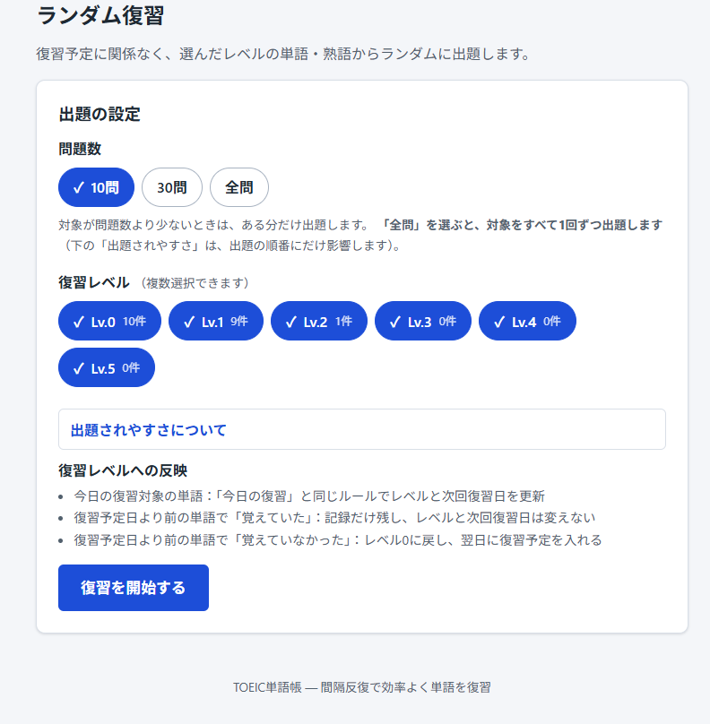
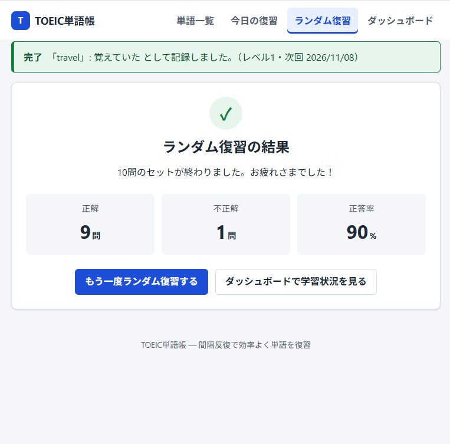
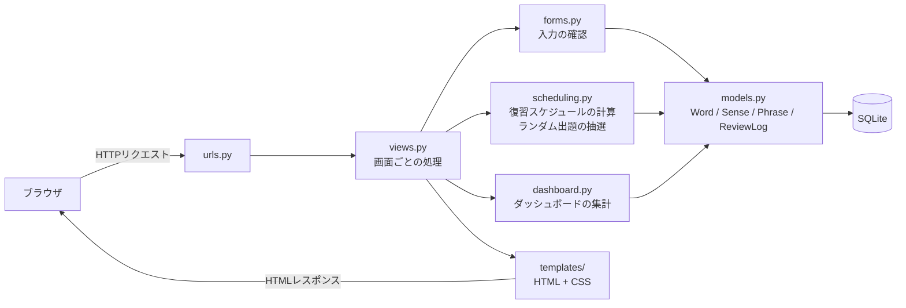
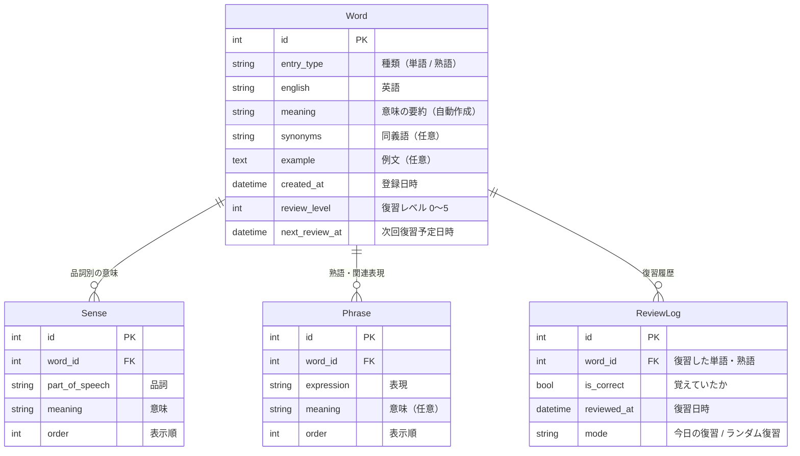

# TOEIC単語帳 ― 品詞別に整理して登録し、復習レベルで出題頻度を調整する英単語アプリ

TOEIC対策の英単語や熟語を **品詞ごとに整理して登録** し、復習の結果（覚えていたかどうか）に応じて **次の復習日や出題されやすさを調整する** Webアプリです。
Python / Django で個人開発しています。

> 復習のタイミングや出題の重みは、あらかじめ決めたルール（間隔反復と重み付きランダム抽選）で計算しています。
> アプリの機能として、機械学習やAIによる予測・判定は組み込んでいません。

### このアプリのポイント

1. **意味を品詞ごとに整理して登録** ― 1つの英単語に複数の品詞・意味・関連表現・同義語・例文をまとめて登録でき、熟語は独立した問題としても登録できます
2. **2種類の復習** ― 間隔反復で「今日復習すべきもの」を出題する **今日の復習** と、復習レベルが低いものほど出やすい **ランダム復習** を使い分けられます
3. **学習履歴の記録とテスト** ― 復習1回ごとの結果を保存してダッシュボードで確認でき、計算ルールや画面の動作を202件の自動テストで確認しています

---

## 目次

- [スクリーンショット](#スクリーンショット)
- [開発背景と目的](#開発背景と目的)
- [主な機能](#主な機能)
- [使用技術](#使用技術)
- [システム構成](#システム構成)
- [復習の仕組み](#復習の仕組み)
- [データベースの構成](#データベースの構成)
- [工夫した点](#工夫した点)
- [テスト](#テスト)
- [ローカル環境での起動方法](#ローカル環境での起動方法)
- [今後の改善予定](#今後の改善予定)

---

## スクリーンショット

### 1. 単語・熟語の登録


種類（英単語／熟語・イディオム）を選び、品詞ボタンで「動詞」と「形容詞」を選んだ状態です。
選んだ品詞の入力欄だけが開き、熟語・同義語・例文は必要なときだけ開いて入力します。

### 2. 今日の復習


「答えを見る」を押して、品詞ごとの意味（名詞・動詞）を表示した状態です。
「覚えていた」「覚えていなかった」の自己採点で、復習レベルと次回復習日が更新されます。

### 3. ランダム復習の設定



問題数と、対象にする復習レベル（複数選択可）を選んで開始します。
各レベルの登録件数と、結果が復習レベルにどう反映されるかを画面に表示しています。

### 4. ランダム復習の結果



1セット（この画像では10問）が終わると、正解数・不正解数・正答率を表示します。
上部のメッセージは、最後の1問の記録内容（レベルと次回復習日）です。

### 5. 学習ダッシュボード


今日の学習状況と登録数のサマリー、過去7日間の日別の復習回数（正解・不正解の内訳つき）、復習レベル別の登録数を表示しています。

---

## 開発背景と目的

TOEICの学習では単語帳アプリを使っていましたが、次の2点に不便さを感じていました。

1. **登録したい情報を整理しにくい**
   1つの英単語に複数の品詞や意味、熟語などを登録しようとしても入力欄が整理されておらず、自分が覚えたい情報を見やすくまとめられませんでした。
2. **新しく覚えたい単語が出題されにくい**
   登録する単語が増えるほど新しい単語が埋もれてしまい、ランダム復習ではなかなか出題されませんでした。

そこで、**品詞ごとに意味や関連表現を整理して登録でき、復習レベルによって出題頻度を調整できる単語帳アプリ** を開発しました。

本アプリは、自身のTOEIC学習経験をもとに機能を企画・設計し、Claude Codeを活用して実装・改善しました。

| 不便だった点 | このアプリでの解決方法 |
|---|---|
| 品詞・意味・熟語をまとめて登録しにくい | 品詞ボタンを選ぶと、その品詞の意味の入力欄だけが開く。熟語・同義語・例文は必要なときだけ開いて入力する |
| 新しい単語がランダム復習で出にくい | 復習レベルが低い（まだ覚えていない）ものほど出題されやすくする重み付きの抽選にする |
| いつ何を復習すればよいか分からない | 復習結果から次回復習日を自動で計算し、今日の分だけを出題する |

## 主な機能

### 単語・熟語の登録と管理
- **品詞別の意味登録**：名詞・動詞・形容詞などのボタンを押すと、その品詞の入力欄だけが開きます。複数の品詞を同時に選べ、意味は1行に1つ入力します
- **関連情報の登録**：熟語・関連表現（「表現 = 意味」の形で1行に1つ）、同義語（カンマ区切り）、例文を登録できます（いずれも任意）
- **熟語を独立した問題として登録**：種類で「熟語・イディオム」を選ぶと、`select A from B` のような熟語を英単語と同じ1問として登録し、復習できます
- **編集・削除**：登録済みの単語・熟語の内容を編集できます（復習レベル・次回復習日・履歴は変わりません）。削除は確認画面を挟み、その復習履歴も一緒に削除します
- **一覧表示**：品詞別の意味・熟語・同義語・例文と、復習レベル・正答率・次回復習予定日を表示します

### 今日の復習（間隔反復）
- 今日が復習予定日のもの（予定日を過ぎたものも含む）を、優先度の高い順に1問ずつ出題します
- 最初は英語だけを表示し、「答えを見る」で品詞別の意味・熟語・同義語・例文を表示します
- 「覚えていた」「覚えていなかった」の **自己採点** で記録し、復習レベル（0〜5）と次回復習予定日を更新します

### ランダム復習
- 問題数を **10問・30問・全問** から選び、対象にする **復習レベル（Lv.0〜Lv.5、複数選択可）** を選んで開始します
- レベルごとの重み **6:5:4:3:2:1**（Lv.0〜Lv.5）で抽選し、低いレベルほど出題されやすくします。Lv.5も出題される可能性は残ります
- 1セットの中で同じ問題は出題しません。「全問」では対象をすべて1回ずつ出題し、重みは出題の順番にだけ影響します
- 「3/10問」のように進み具合を表示し、最後に正解数・不正解数・正答率を表示します
- 復習予定日への影響は次のとおりです（詳しくは [ランダム復習の結果の反映](#5-ランダム復習の結果の反映)）

| 出題された単語・熟語 | 覚えていた | 覚えていなかった |
|---|---|---|
| 今日が復習予定日（または予定日を過ぎている） | 今日の復習と同じくレベルを上げ、次回復習日を延ばす | レベル0に戻し、翌日に復習 |
| 復習予定日より前 | 記録だけ残し、レベルと次回復習日は変えない | レベル0に戻し、翌日に復習 |

### 学習ダッシュボード
- 今日の残り復習数、今日の復習回数・正解回数・正答率、登録数（単語・熟語）、累計復習回数
- 過去7日間の日別の復習回数の棒グラフ（正解・不正解の内訳つき。表でも確認可能）
- 復習レベル別の登録数のグラフ
- 集計には、今日の復習とランダム復習の両方の記録を含みます

### 画面・操作性
- PC・スマートフォンの画面幅に対応したレイアウト
- キーボード操作、フォーカス表示、ラベル付きフォームなどのアクセシビリティへの配慮
- JavaScript を使わず、HTML と CSS だけで画面を作成（品詞ボタンによる入力欄の切り替えやグラフも CSS で実現）

## 使用技術

| 分類 | 技術 |
|---|---|
| 言語 | Python 3.12 |
| フレームワーク | Django 6.1 |
| データベース | SQLite |
| フロントエンド | HTML（Djangoテンプレート）、CSS（JavaScript は不使用） |
| テスト | Django標準のテスト機能（`unittest` ベース） |
| バージョン管理 | Git |

外部の Python パッケージは Django とその依存パッケージのみです（[requirements.txt](requirements.txt)）。

## システム構成



画面の処理（views.py）から、**復習スケジュールの計算・抽選（scheduling.py）とダッシュボードの集計（dashboard.py）を別のファイルに分けて** います。
計算方法を改良するときに、画面側のコードを変更せずに済むようにするためです。

<details>
<summary>ディレクトリ構成と画面一覧（クリックで開く）</summary>

### ディレクトリ構成

```
toeic-review-app/
├── config/                 # プロジェクト全体の設定（settings.py, urls.py など）
│   └── env.py              # .env ファイルの読み込み
├── vocab/                  # 単語学習アプリ本体
│   ├── models.py           # データベースの設計（Word, Sense, Phrase, ReviewLog）
│   ├── views.py            # 画面ごとの処理
│   ├── urls.py             # URLと画面の対応
│   ├── forms.py            # 単語・熟語の登録／編集フォーム、ランダム復習の設定フォーム
│   ├── scheduling.py       # 復習スケジュールの計算（間隔反復）とランダム出題の抽選
│   ├── dashboard.py        # ダッシュボードの集計
│   ├── admin.py            # Django管理画面の設定
│   ├── tests.py            # 自動テスト
│   ├── migrations/         # データベースの変更履歴（既存データの移行を含む）
│   ├── templates/vocab/    # HTMLテンプレート（入力欄・意味の表示は部品化して共通利用）
│   └── static/vocab/css/   # CSS
├── scripts/
│   └── create_env.py       # ローカル開発用の .env を作成するスクリプト
├── docs/images/            # README用のスクリーンショット
├── .env.example            # 環境変数の設定例（本物の秘密鍵は書かない）
├── manage.py
└── requirements.txt
```

### 画面一覧

| URL | 画面 |
|---|---|
| `/` | 単語一覧・単語／熟語の登録 |
| `/words/<id>/edit/` | 編集 |
| `/words/<id>/delete/` | 削除の確認 |
| `/review/` | 今日の復習（出題） |
| `/review/<id>/answer/` | 今日の復習の回答の保存（POSTのみ。保存後は `/review/` へリダイレクト） |
| `/random/` | ランダム復習の設定 |
| `/random/question/` | ランダム復習の出題 |
| `/random/answer/` | ランダム復習の回答の保存（POSTのみ） |
| `/random/result/` | ランダム復習の結果 |
| `/dashboard/` | ダッシュボード |
| `/admin/` | Django管理画面 |

</details>

## 復習の仕組み

**間隔反復**（覚えているものほど復習の間隔を空け、忘れたものはすぐに復習する方法）を、シンプルなルールで実装しています。
実装は [vocab/scheduling.py](vocab/scheduling.py) にまとめています。英単語も熟語も同じルールです。

### 1. 復習レベルと次回復習日のルール

各単語・熟語は **復習レベル（0〜5）** と **次回復習予定日時** を持っています。

- 登録直後：レベル0。次回復習予定は登録した時刻（すぐに今日の復習の対象になります）
- 「覚えていた」：レベルを1つ上げる（上限は5）
- 「覚えていなかった」：レベルを0に戻す

```
正解したとき:   新しいレベル = min(現在のレベル + 1, 5)
不正解のとき:   新しいレベル = 0

次回復習予定日時 = 復習した日時 + 間隔（新しいレベルで決まる）
```

| 新しいレベル | 0（不正解） | 1 | 2 | 3 | 4 | 5 |
|---|---|---|---|---|---|---|
| 次回復習までの間隔 | 1日 | 1日 | 3日 | 7日 | 14日 | 30日 |

間隔の日数はコード内の定数（`REVIEW_INTERVAL_DAYS`、`INCORRECT_INTERVAL_DAYS`）として管理しているため、変更も簡単です。

### 2. 具体例

4月1日に単語 `negotiate` を登録し、今日の復習で出題されるたびに回答した場合の例です。

| 復習した日 | 回答 | レベルの変化 | 次回復習日 |
|---|---|---|---|
| 4月1日（登録日） | 覚えていた | 0 → **1** | 1日後の **4月2日** |
| 4月2日 | 覚えていた | 1 → **2** | 3日後の **4月5日** |
| 4月5日 | 覚えていなかった | 2 → **0**（リセット） | 翌日の **4月6日** |
| 4月6日 | 覚えていた | 0 → **1** | 1日後の **4月7日** |
| 4月7日 | 覚えていた | 1 → **2** | 3日後の **4月10日** |

覚えているものは出題の間隔が少しずつ延び、忘れたものは翌日からやり直しになります。

### 3. 今日の復習の対象と出題順

```
今日の復習対象  ⇔  次回復習予定日時 < 明日の0:00（日本時間）
```

時刻ちょうどではなく **「今日中に予定があるもの」** を対象にしています。
データベースの日時はUTC（協定世界時）で保存されますが、日付の区切りは `TIME_ZONE = "Asia/Tokyo"` を基準に計算しています。

対象が複数ある場合は、次の順に並べて先頭の1問を出題します。条件が同じなら毎回同じ順番になるので、動作を予測でき、テストで確かめることもできます。

1. 次回復習予定日時が古い順（長く待たされているものを先に）
2. 不正解回数が多い順（苦手なものを先に）
3. 復習レベルが低い順
4. 登録IDの順

### 4. ランダム復習の出題（重み付き抽選）

選んだレベルの単語・熟語から、次の重みで抽選します。

| 復習レベル | Lv.0 | Lv.1 | Lv.2 | Lv.3 | Lv.4 | Lv.5 |
|---|---|---|---|---|---|---|
| 重み | 6 | 5 | 4 | 3 | 2 | 1 |

たとえば、Lv.0 の1問は Lv.5 の1問より6倍選ばれやすくなります。
1問選ぶたびにそれを候補から外して次を選ぶ（くじを箱に戻さない）ので、1セットの中で同じ問題は出ません。
「全問」の場合は対象をすべて出題するため、重みは「どれが先に出やすいか」だけに影響します。

### 5. ランダム復習の結果の反映

ランダム復習では、復習予定日より前のものも出題されます。そのため、結果の反映方法を次のように決めています。

- **今日が復習予定日（または予定日を過ぎている）**：今日の復習と同じルールで更新します
- **予定日より前に「覚えていた」**：記録だけ残し、レベルと次回復習日は変えません。予定より早く思い出せただけでは、間隔を延ばす根拠として弱いと考えたためです
- **予定日より前に「覚えていなかった」**：レベル0に戻し、翌日に復習します。忘れていると分かった時点で、予定を待たずにやり直すためです

計算には今日の復習と同じ関数（`calculate_next_review()`）を使い、どちらで復習したかは履歴に記録しています。

## データベースの構成



- **Word**：単語または熟語1件と、その現在の復習スケジュール。熟語を独立した問題として登録するときも、`entry_type` を変えて同じ Word として保存し、復習の仕組みを共通化しています
- **Sense**：品詞ごとの意味（1つの Word に複数）。熟語の意味は品詞「その他」として保存します
- **Phrase**：英単語に付ける熟語・関連表現。独立した問題（`entry_type` が熟語の Word）とは別のもので、自動で変換はしません
- **ReviewLog**：復習1回分の結果。復習するたびに1行追加し、上書きはしません。復習回数・正答率などはここから集計しています（Django ORM の `annotate` / `aggregate` を使用）
- Word を削除すると、関連する Sense・Phrase・ReviewLog も一緒に削除されます

## 工夫した点

### 1. 計算処理を画面から切り離し、テストしやすくした
次回復習日の計算はデータベースを使わない関数 `calculate_next_review()` に、ランダム出題の抽選は `weighted_sample()` にまとめました（[vocab/scheduling.py](vocab/scheduling.py)）。
抽選に使う乱数は外から渡せるようにしているため、テストでは乱数の種を固定して結果を再現し、重みどおりの割合で選ばれるかも確認しています。

### 2. 入力欄を整理し、JavaScript なしで切り替えた
品詞ボタンを押した品詞の入力欄だけを表示し、熟語・同義語・例文は必要なときだけ開く形にしました。
切り替えは CSS の `:has()` セレクタで実現しています。対応していない古いブラウザでも、すべての入力欄が表示されるだけで入力・保存はできます。
登録と編集は同じフォームと入力欄の部品を使い回しています。

### 3. 復習結果の二重記録を防ぐ
- 回答の保存は POST のみで受け付け、保存後はリダイレクトします（PRGパターン）。再読み込みでは記録が増えません
- 今日の復習では、画面を表示したときの次回復習予定日時をフォームに入れて送り、今の値と一致するときだけ記録します。ダブルクリックの2回目や、「戻る」で表示した古い画面からの送信は記録しません
- ランダム復習では、セットのIDと何問目かを一緒に送り、今の進み具合と一致するときだけ記録します
- ほぼ同時に届いた送信は、1件ずつ順番に処理します。ただし、この方法は開発用サーバーのように1つのプロセスで動かす場合を想定したものです
- 履歴の追加と復習スケジュールの更新はトランザクションでまとめ、CSRF対策は Django 標準の仕組みを使っています

### 4. 既存の学習データを失わずに機能を追加した
復習結果は上書きせず、1回ごとに ReviewLog へ追加しています。
品詞別の意味を追加したときは、それまでの意味を品詞「その他」として移すデータ移行（マイグレーション）を作り、登録済みの単語・復習レベル・履歴を保ったまま新しい形式に移行しました。

### 5. 日本時間での「今日」を正しく扱った
データベースはUTCで日時を保存するため、そのまま日付を取り出すと、日本時間の0時〜9時の記録が前日扱いになってしまいます。
今日の復習の対象やダッシュボードの日別集計は、日本時間で日付を区切って計算し、23:59 や 0:00 といった境界の時刻もテストで確認しています。

### 6. 秘密情報をソースコードに書かない
Django の秘密鍵は環境変数（ローカル開発では `.env` ファイル）から読み込み、リポジトリには含めていません。
`.env` を作るスクリプトも用意し、初めての人でも簡単に起動できるようにしました。

## テスト

```powershell
python manage.py test vocab
```

**202件** の自動テストがあり、すべて成功することを確認しています。

| 分類 | 件数 | 主な確認内容 |
|---|---|---|
| 登録・編集・削除 | 65 | 品詞別の意味・熟語・同義語の保存、入力エラー（意味なし・「=」の入れ忘れなど）、熟語の独立登録、編集しても復習予定が変わらないこと、削除 |
| 今日の復習 | 26 | 答えが最初は隠れていること、回答の保存、ダブルクリック・古い画面からの送信で記録が増えないこと、翌日には再び回答できること |
| ランダム復習 | 36 | 重みどおりの出題割合・重複なし・問題数とレベルの絞り込み、予定日前／当日の結果の反映、二重送信・削除された単語の扱い、結果画面 |
| 間隔反復の計算と出題順 | 17 | 各レベルの間隔・上限・不正解でのリセット、今日の判定の境界、出題の優先順位 |
| 集計・ダッシュボード | 19 | 復習回数・正答率、今日の集計、過去7日間の日別集計、レベル別の登録数 |
| 画面の構成・文言 | 25 | 全テンプレートの読み込み、HTMLタグの対応、ナビゲーション、フォームの表示、CSS の切り替えルール |
| データ移行・その他 | 14 | 既存データのマイグレーション、モデルの初期値、`.env` の読み込み |

テストでは現在日時を固定しているため、実行する日によって結果が変わりません（標準ライブラリの `unittest.mock` を使用）。
ブラウザを操作するテスト（E2Eテスト）はまだありません。画面の見た目や操作は手動で確認しています。
テストの実行にも `.env`（または環境変数 `DJANGO_SECRET_KEY`）が必要です。

## ローカル環境での起動方法

### 必要なもの
- Python 3.12
- Git

### 手順（Windows / PowerShell）

```powershell
# 1. リポジトリを取得してフォルダに移動
git clone https://github.com/tenten-projects/toeic-review-app.git
cd toeic-review-app

# 2. 仮想環境を作成して有効化
python -m venv .venv
.venv\Scripts\Activate.ps1

# 3. 必要なパッケージをインストール
pip install -r requirements.txt

# 4. 秘密鍵を入れた .env ファイルを作成（最初の1回だけ）
python scripts/create_env.py

# 5. データベースを作成
python manage.py migrate

# 6. 開発用サーバーを起動
python manage.py runserver
```

ブラウザで http://127.0.0.1:8000/ を開くと、単語一覧画面が表示されます。
2回目以降は、手順2の仮想環境の有効化と、手順6の `runserver` だけで起動できます。

- macOS / Linux の場合は、手順2の有効化コマンドを `source .venv/bin/activate` に読み替えてください
- 手順2で「スクリプトの実行が無効」というエラーが出る場合は、先に `Set-ExecutionPolicy -Scope Process RemoteSigned` を実行してください（今開いているPowerShellの画面だけに適用されます）
- データベース（`db.sqlite3`）はリポジトリに含めていません。手順5で空のデータベースが作成されます

### 環境変数の設定

Django の秘密鍵（`SECRET_KEY`）は、ソースコードには書かず、環境変数 `DJANGO_SECRET_KEY` から読み込んでいます。

| 環境変数 | 必須 | 内容 |
|---|---|---|
| `DJANGO_SECRET_KEY` | 必須 | Django の秘密鍵。推測されにくい長いランダムな文字列 |

ローカル開発では、プロジェクト直下の `.env` ファイルに書いておくと、起動時に自動で読み込まれます（[config/env.py](config/env.py)）。

- **`python scripts/create_env.py`** を実行すると、ランダムな秘密鍵が入った `.env` が自動で作られます。すでに `.env` がある場合は上書きしません
- 手動で作る場合は、[.env.example](.env.example) を `.env` という名前でコピーし、`DJANGO_SECRET_KEY=` の後に値を書いてください
- `.env` は `.gitignore` で除外しているため、リポジトリには含まれません。**他の人に共有したり、コミットしたりしないでください**
- 同じ名前の環境変数がすでに設定されている場合は、`.env` よりもそちらが優先されます
- 秘密鍵が設定されていない状態で起動すると、作成方法を案内するエラーメッセージが表示されます

### 管理画面を使う場合（任意）

```powershell
python manage.py createsuperuser
```

作成したアカウントで http://127.0.0.1:8000/admin/ にログインすると、単語・熟語と復習履歴を確認できます。

## 今後の改善予定

以下は **まだ実装していない** 機能です。

- ユーザー登録・ログイン機能（ユーザーごとに単語帳を分ける）
- 単語・熟語の検索と絞り込み
- 本番環境向けの設定（`DEBUG`・`ALLOWED_HOSTS` の環境変数化、HTTPS関連の設定、複数プロセスで動かす場合の二重送信対策など）と、Webサーバーへのデプロイ
- 正答率や復習の遅れを考慮した、復習間隔の調整方法の検討
- 1日に復習する数の上限設定
- 連続学習日数の表示、今後の復習予定数の表示
- ブラウザを使ったE2Eテストの追加
